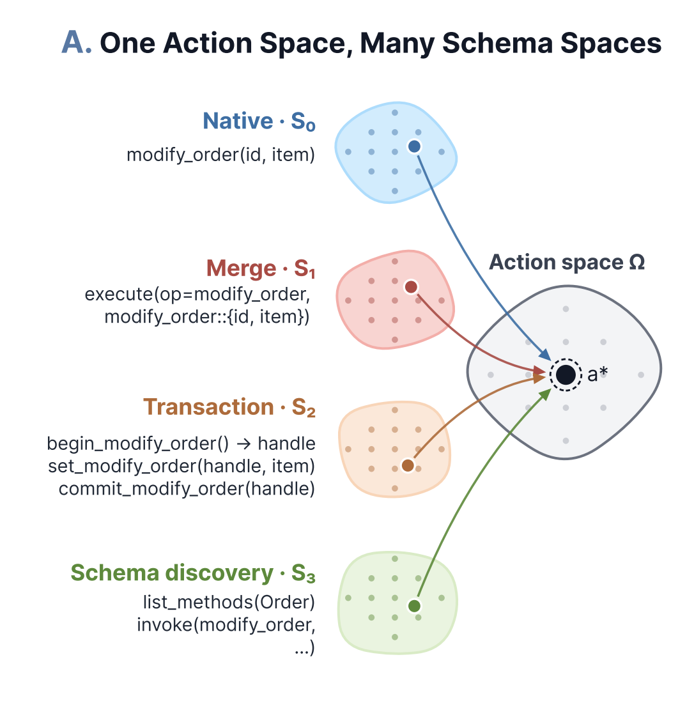
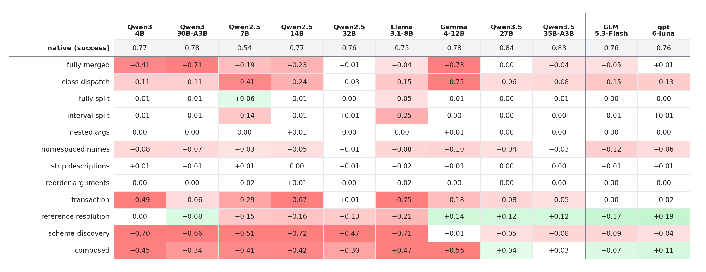
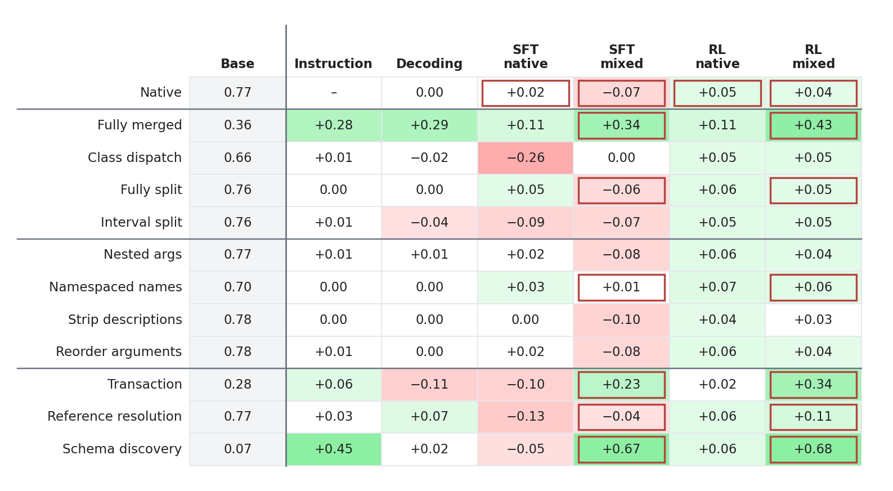

# Tool Schema Bias for Agentic Environments
Date: Oct 16, 2026 | Author: Yinhong Liu

Using LLMs to solve agentic tasks through tool calls has become an everyday pattern. Yet an agent environment usually comes with one fixed tool schema, and whether we are evaluating or training, the model learns to interact with the environment through that single schema. We noticed an interesting fact here: **what defines an agent environment is the action space that can actually be executed in it, while the tool schema is merely one interface protocol to that action space**. Such a protocol is not unique; in fact, we can define infinitely many of them.

We believe that if an LLM truly understands an action space, its performance should not depend much on which interface represents it. Yet, perhaps unsurprisingly, our experiments show that LLMs behave inconsistently across interface schemas. We call this phenomenon **Schema Bias**.

## Same action, different ways to say it

Take a flight-booking environment where we want to move a reservation to another flight. This action can be a standalone tool, it can be merged into one large tool with an `action` argument, or it can be split into a three-step begin / set / commit transaction:

```python
change_flight(reservation_id="R1", flight="BA117")                         # native

manage_reservation(action="change", reservation_id="R1", flight="BA117")   # merge

flight_change_event_handle = begin_change_flight()                         # transaction
set_change_flight(txn_id=flight_change_event_handle, reservation_id="R1", flight="BA117")
commit_change_flight(txn_id=flight_change_event_handle)
```

All three do exactly the same thing and reach exactly the same environment state. The **action space** decides *what can be done*; the **tool schema** only decides *how to say it*.

Mainstream benchmarks such as τ²-bench (Barres et al. 2025) and BFCL (Yan et al. 2024) each expose one fixed schema per environment. In reinforcement learning, it has long been known that how the action space is represented affects learning (Kanervisto et al. 2020); for LLM agents, however, the question has rarely been tested systematically.

<p align="center"></p>
<p align="center"><sub><b>Fig. 1.</b> One action space Ω can have many schema representations: the calls under native, merge, transaction and schema discovery all differ, yet they map to the same native action a*.</sub></p>

## What we did

Using nine rewriting operators (merging and splitting tools, changing the argument structure, renaming, stripping descriptions, splitting one call into a multi-step flow, and more), we built up to 32 schema variants and evaluated 11 models on one synthetic benchmark and four real benchmarks (τ²-bench, BFCL, AutomationBench, MCP-Atlas). Every call made under a variant decodes back to the original action, and the tasks and environments stay the same, so any change in score comes from the schema alone.

## How large is schema bias?

Across these variants, whether tools are merged or split, arguments restructured, or the calling flow changed, nearly every model degrades to some degree. Changing only the schema can take a model from near-perfect to zero, and neither the newest open models nor closed models are exempt.

<p align="center"></p>
<p align="center"><sub><b>Fig. 2.</b> Change in success rate from the native schema, per model and variant, on the synthetic benchmark (green: gain, red: loss). Note how colours differ along a single row: the same schema is harmless to some models and fatal to others.</sub></p>

More interestingly, no schema is safe for every model: a representation that barely affects one model can be catastrophic for another. So "which schema is hardest" is itself a model-dependent question.

We also see that different models and schema structures fail for distinctive reasons. Breaking failed trajectories down, the *shape* of a failure tends to follow the schema: under a transaction, models often begin and then forget to commit; under a merged dispatcher, they pick the wrong branch; after a rejected call, some models repeat the same wrong call over and over, stuck in a **livelock**. Put simply, **the schema decides how a model fails, and the model decides how much it fails**.

## Can we predict it in advance?

How can we predict a model's performance under schema bias? Rerunning the full evaluation for every new schema is not practical. This leads to two questions: is the bias model-dependent, and does it depend on the query distribution of the test set?

We compared two kinds of estimators. One uses no real tasks: it looks only at features of the schema itself (such as the number of tools or the argument structure), or at the model's likelihood of the correct calls. The other samples a small batch of target queries and actually runs them.

The conclusion is clear: neither the schema's features nor the model's likelihood of it can tell whether the schema is hard on real tasks, whereas a few dozen target queries already rank the variants close to the full evaluation. After training this is even more pronounced: likelihood decouples completely from real performance and is sometimes even anti-correlated with it.

Back to the two questions. The bias is model-dependent: the same schemas rank differently in difficulty across models, so one model's results cannot be carried over to another. It also depends on the query distribution: whether a schema is hard depends on what the target tasks ask the model to do, which cannot be seen from the schema alone. To estimate it well, there is no way around real queries.

## Can we mitigate it?

Finally, we asked whether schema bias can be mitigated, with or without training.

Without training, explaining the calling convention in the prompt helps little; constrained decoding fixes the format but not the semantics: every call is now valid, yet the model still gets lost in multi-step flows.

With training, we ran SFT and RL (GRPO; Shao et al. 2024) on native data and on a mixture of variants:

- training only on native leaves the bias essentially intact;
- SFT on the mixture improves the variants it has seen, but pays a "tax" on the ones it has not;
- RL on the mixture repairs the variants it has seen without losing performance on native.

<p align="center"></p>
<p align="center"><sub><b>Fig. 3.</b> Change from the untrained Qwen3-4B for each intervention on the synthetic benchmark; a red frame marks a variant that is in that method's training data. The green cells fall almost entirely inside the red frames; the red outside the frames in the SFT mixed column is the "tax" it pays.</sub></p>

But this repair generalizes only so far: it carries over to new combinations of rewrites seen in training, and helps little with a kind of rewrite never seen. The same holds on real benchmarks, where gains appear almost only on the schemas seen in training. What training repairs is, by and large, what it has seen.

## Final thoughts

Evaluating on a single fixed schema conflates "can the model do the task" with "is the model used to this way of writing it". Back to the flight-change example: an agent that truly knows how to change a flight should not fail just because one tool became three steps. As agents are deployed into more and more tool environments designed by different people, interfaces will only become more diverse. So here is a simple suggestion: next time you evaluate your agent, rerun it on two equivalent schemas and see how much of the score is left.

The code, the synthetic benchmark and the adapters for the four real benchmarks are open source: [ToolSchemaSpace](https://github.com/williamLyh/ToolSchemaSpace) · [Paper](https://arxiv.org/abs/2609.34971)

## Citation

```bibtex
@article{liu2026actionspace,
  title   = {Action-Space Shaping for {LLM} Agents: Measuring and Mitigating Tool-Schema Bias},
  author  = {Liu, Yinhong and Tan, Zhili and Wang, Zilin and Guo, Zhijiang},
  journal = {arXiv preprint arXiv:2609.34971},
  year    = {2026},
  url     = {https://arxiv.org/abs/2609.34971}
}
```

## References

[1] Barres et al. "τ²-bench: Evaluating Conversational Agents in a Dual-Control Environment." arXiv:2506.07982 (2025).

[2] Yan et al. "Berkeley Function Calling Leaderboard." (2024).

[3] Kanervisto, Scheller and Hautamäki. "Action Space Shaping in Deep Reinforcement Learning." IEEE Conference on Games (2020).

[4] Shao et al. "DeepSeekMath: Pushing the Limits of Mathematical Reasoning in Open Language Models." arXiv:2402.03300 (2024).
